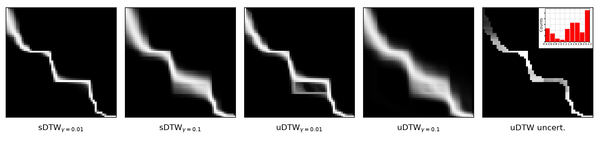
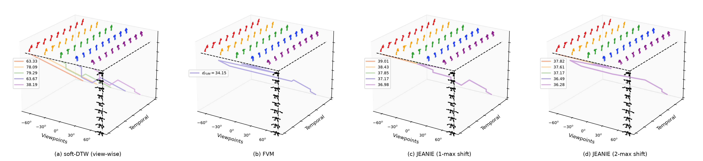

# torchwarp

An unofficial, faster PyTorch/CUDA implementation of uncertainty-DTW
(uDTW, ECCV 2022) and JEANIE (IJCV 2024), both proposed by Lei Wang,
Piotr Koniusz et al.

## What torchwarp provides

| method | in torchwarp | faster than the official code |
| --- | --- | --- |
| Euclidean distance | `euclidean_cost`, `squared_euclidean_cost` | no (plain PyTorch) |
| DTW | no; used only as a baseline loss in `examples/ecg5000_forecast.py` | no |
| soft-DTW (sDTW) | `soft_dtw` | CUDA kernel, not benchmarked |
| soft-DTW divergence (sDTW div.) | built from `soft_dtw`, see below | CUDA kernel, not benchmarked |
| uDTW | `uDTW`, `udtw_from_features`, `udtw_from_matrices` | yes, see [Speed](#speed) |
| Free Viewpoint Matching (FVM) | `fvm_query_only_1d`, `fvm_query_only_2d`, ... | yes, see [Speed](#speed) |
| JEANIE | `JEANIE`, `jeanie_1d_from_features`, ... | yes, see [Speed](#speed) |

uDTW, FVM and JEANIE are the accelerated methods; they run as CUDA
kernels on the GPU and as a vectorised PyTorch program on the CPU, and
give the same values and gradients as the official code. The soft-DTW
divergence of two sequences x and y is
sDTW(x, y) - ½ [sDTW(x, x) + sDTW(y, y)].

## Installation

With pip:

```bash
git clone https://github.com/hibana2077/torchwarp && cd torchwarp
pip install -r requirements.txt -e .
```

With uv (pick `cu126`, `cu128` or `cpu`):

```bash
git clone https://github.com/hibana2077/torchwarp && cd torchwarp
uv sync --extra cu126
```

Optional, only to draw path figures (installs matplotlib):

```bash
pip install -e ".[vis]"
uv sync --extra cu126 --extra vis
```

## Usage

### uDTW

uDTW compares two sequences, for example two time series, or two
skeleton sequences encoded as one feature vector per temporal block.
Each time step i of a sequence has an uncertainty σ<sub>i</sub> > 0,
predicted from the features by a small network (SigmaNet in the
paper). For time steps i of X and j of Y, uDTW uses the variance
Σ<sub>ij</sub> = ½ (σ<sub>i</sub>² + σ'<sub>j</sub>²) and returns two
tensors of shape `[batch]`, one entry per pair (X[b], Y[b]):

* `d`: the uDTW distance (Eq. 2), the soft minimum over all warping
  paths of the sum of ‖x<sub>i</sub> - y<sub>j</sub>‖² / Σ<sub>ij</sub>
  along the path;
* `omega`: the penalty Ω (Eq. 3), β times the sum of log Σ<sub>ij</sub>
  along the same soft-selected path.

With `normalize=True` both are returned as
d(X, Y) - ½ [d(X, X) + d(Y, Y)].

```python
import torch
import torch.nn as nn
import torchwarp

# two batches of sequences: [batch, length, features]
X = torch.randn(16, 30, 8, device="cuda", requires_grad=True)
Y = torch.randn(16, 40, 8, device="cuda")

# uncertainty sigma per time step: [batch, length, 1], positive
sigma_net = nn.Sequential(
    nn.Linear(8, 32),
    nn.ReLU(),
    nn.Linear(32, 1),
    nn.Softplus(),
).cuda()
sx = sigma_net(X) + 1e-3
sy = sigma_net(Y) + 1e-3

# d and omega: [batch], one distance and one penalty per pair
udtw = torchwarp.uDTW(gamma=1.0, normalize=True)
d, omega = udtw(X, Y, sx, sy, beta=1.0)
loss = (d + omega).mean()
loss.backward()
```

`uDTW` uses the squared Euclidean distance between time steps. To use
another distance between time steps, build the two `[batch, len_x, len_y]`
matrices of Eq. 2 and Eq. 3 yourself, cost<sub>ij</sub> =
d(x<sub>i</sub>, y<sub>j</sub>) / Σ<sub>ij</sub> and penalty<sub>ij</sub>
= β log Σ<sub>ij</sub>, and pass them to `udtw_from_matrices`. Here
`pairwise_matrices` returns the default cost, the penalty and Σ, and the
cost is replaced by the cosine distance
d(x<sub>i</sub>, y<sub>j</sub>) = 1 - cos(x<sub>i</sub>, y<sub>j</sub>):

```python
# default matrices, each [batch, len_x, len_y]
cost, penalty, Sigma = torchwarp.pairwise_matrices(X, Y, sx, sy, beta=1.0)

# cosine distance between time steps instead of the squared Euclidean one
cos = nn.functional.cosine_similarity(X.unsqueeze(2), Y.unsqueeze(1), dim=-1)
d, omega = torchwarp.udtw_from_matrices((1 - cos) / Sigma, penalty, gamma=1.0)
```

### JEANIE

JEANIE compares two 3D skeleton sequences over time and camera
viewpoint. The support sequence is used as recorded. The query is
rotated to K simulated camera viewpoints before it is encoded;
torchwarp does not do this rotation, so the query you pass already has
the viewpoint axis. The example below rotates the 3D joints of the
query about the vertical axis by each angle, splits both sequences into
temporal blocks of 8 frames, and encodes each block with a linear
layer:

```python
import math

# simulated camera viewpoints (degrees about the vertical axis)
angles = [-60, -30, 0, 30, 60]


def rotate(skeleton, degrees):
    a = math.radians(degrees)
    R = torch.tensor([[math.cos(a), 0.0, math.sin(a)],
                      [0.0, 1.0, 0.0],
                      [-math.sin(a), 0.0, math.cos(a)]])
    return skeleton @ R.T


# [frames, joints, 3] -> [blocks, size * joints * 3]
def blocks(skeleton, size=8, stride=4):
    return skeleton.unfold(0, size, stride).flatten(1)


# skeleton sequences: [frames, joints, 3]
query_skeleton = torch.randn(32, 20, 3)
support_skeleton = torch.randn(32, 20, 3)
encoder = nn.Linear(8 * 20 * 3, 64)

# query: [views, blocks, features], support: [blocks, features]
query = torch.stack(
    [encoder(blocks(rotate(query_skeleton, a))) for a in angles])
support = encoder(blocks(support_skeleton))

# dist: [batch]
jeanie = torchwarp.JEANIE(gamma=0.1, max_shift=1)
dist = jeanie(query.unsqueeze(0), support.unsqueeze(0))
```

Here a skeleton sequence is `[frames, joints, 3]`, `query` is
`[views, blocks, features]` and `support` is `[blocks, features]`;
`JEANIE` takes a batch, `[batch, views, blocks, features]` and
`[batch, blocks, features]`, and returns `dist` of shape `[batch]`, the
JEANIE distance of each query and support pair. `max_shift` is the
ι-max shift: along the path, the viewpoint index changes by at most ι
from one step to the next.

The accumulator tensor R of Algorithm 1, `[batch, views, blocks_q,
blocks_s]`, is returned with:

```python
# R: [batch, views, blocks_q, blocks_s]
dist, R = jeanie(query.unsqueeze(0), support.unsqueeze(0),
                 return_accumulator=True)
```

With two viewpoint axes (azimuth and altitude) the query is
`[batch, views_az, views_alt, blocks, features]` and `max_shift` is a
pair. FVM takes the matrix of base distances between every query view
and the support:

```python
# base distances: [batch, views, blocks_q, blocks_s]
D = torchwarp.euclidean_cost(query.unsqueeze(0), support.unsqueeze(0))
d_fvm = torchwarp.fvm_query_only_1d(D, gamma=0.1)
```

### Visualization (optional)

`torchwarp.plot` draws the alignment paths of uDTW, soft-DTW, FVM and
JEANIE for sequences you pass in. torchwarp does not ship or download
a pretrained model: the paths depend on the features you give, so use
features from your own trained model. With untrained features the
figures can still be drawn but the paths have no meaning.

The two figures below come from the uDTW model trained by
`examples/ecg5000_forecast.py` and the JEANIE encoder trained by
`examples/nwucla_fewshot.py` (seed 42). To draw them again:

```bash
python examples/ecg5000_forecast.py --loss udtw --seeds 42 --save-ckpt examples/results/ckpt
python examples/nwucla_fewshot.py --method jeanie --seeds 42 --save-ckpt examples/results/ckpt
python examples/plot_paths.py
```

#### uDTW

Paths of sDTW and uDTW for two values of γ, and the uncertainty Σ on
the path:

```python
from torchwarp import plot

# sDTW and uDTW paths for each gamma, and uDTW uncertainty
fig = plot.udtw_figure(X, Y, sx, sy, gammas=(0.01, 0.1))
fig.savefig("udtw_paths.png")
```

The paths are also available without matplotlib:

```python
a = torchwarp.paths.udtw(X, Y, sx, sy, gamma=0.01)

a.path_matrix   # [batch, len_x, len_y]
a.optimal_path  # per pair: [(i, j), ...]
a.Sigma         # [batch, len_x, len_y]
```

`a.path_matrix` (`[batch, len_x, len_y]`) is
SoftMinSel<sub>γ</sub>(w, [Π<sub>i</sub>]): the path matrices
Π<sub>i</sub> of all paths, weighted by the soft-selector of Eq. 3 over
their path distances w<sub>i</sub>; it is what the first four panels
of the uDTW figure show.
`a.optimal_path` is the path with the smallest distance, a list of
cells (i, j) per pair. `a.Sigma` holds the variances Σ<sub>ij</sub>.
`a.path_matrix` is also the gradient of the uDTW distance with respect
to the cost matrix:

```python
with torch.no_grad():
    cost, penalty, Sigma = torchwarp.pairwise_matrices(X, Y, sx, sy)
cost.requires_grad_(True)

d, omega = torchwarp.udtw_from_matrices(cost, penalty, gamma=0.01)
d.sum().backward()

cost.grad  # equals a.path_matrix
```

ECG5000, forecast of the trained uDTW model vs. ground truth for one
test series:



#### Meet JEANIE

Paths in 3D (viewpoint, query time, support time) for soft-DTW applied
to each viewpoint separately, FVM, and JEANIE with each `max_shift` in
the tuple:

```python
# soft-DTW per view, FVM, and one JEANIE panel per max_shift
fig = plot.viewpoint_figure(query, support, angles, max_shift=(1, 2))
fig.savefig("viewpoint_paths.png")
```

To also draw the skeletons, pass `query_poses`, `support_poses` and
`bones`. Without matplotlib:

```python
a = torchwarp.paths.jeanie(query, support, gamma=0.1, max_shift=1)

a.path_matrix   # [views, blocks_q, blocks_s] per pair
a.optimal_path  # per pair: [(t, u, view), ...]
```

Here `a.path_matrix` is `[batch, views, blocks_q, blocks_s]` and each
cell of `a.optimal_path` is (t, u, view).

NW-UCLA, a query and a support sequence of the same action (donning),
JEANIE with 1-max and 2-max shift:



## Results

Mean ± std over seeds 42, 43, 44. Hyperparameters are the defaults in [`examples/`](examples/); run `bash examples/download_data.sh` and then `python examples/ecg5000_forecast.py --loss <loss>` or `python examples/nwucla_fewshot.py --method <method>`.

### Speed

Mean time per training step (ms), official implementation vs torchwarp on the same task and settings.

| method (task) | official CPU | torchwarp CPU | speed-up | official GPU | torchwarp GPU | speed-up |
| --- | --- | --- | --- | --- | --- | --- |
| uDTW (ECG5000) | 957.6 | 84.6 | 11× | 1809.7 | 1.35 | 1345× |
| uDTW (NW-UCLA) | 37.5 | 22.0 | 1.7× | 92.2 | 6.18 | 15× |
| FVM (NW-UCLA) | 157.6 | 5.75 | 27× | 363.9 | 2.93 | 124× |
| JEANIE (NW-UCLA) | 961.8 | 10.03 | 96× | 2362.3 | 2.17 | 1091× |

### Time series forecasting on ECG5000

UCR ECG5000: forecast the last 40% of each series from the first 60%. Rows: training loss; columns: test metric (lower is better).

| training loss | MSE | DTW | sDTW div. | uDTW |
| --- | --- | --- | --- | --- |
| Euclidean | 0.2161 ± 0.0065 | 5.5127 ± 0.3189 | 7.8376 ± 0.3005 | 2.5342 ± 0.0911 |
| DTW | 0.7299 ± 0.1767 | 5.3317 ± 0.4190 | 19.0465 ± 3.5771 | 9.3703 ± 2.7353 |
| sDTW | 0.7265 ± 0.1751 | 5.3920 ± 0.4921 | 18.9393 ± 3.6078 | 9.2567 ± 2.6598 |
| sDTW div. | 0.7248 ± 0.1845 | 5.3684 ± 0.5537 | 19.0471 ± 3.7483 | 9.2619 ± 2.7557 |
| uDTW | 0.2698 ± 0.0138 | 6.8878 ± 0.4812 | 8.4908 ± 0.4687 | 2.7986 ± 0.1459 |

### Few-shot action recognition on NW-UCLA

Cross-view 5-way 1-shot action recognition on NW-UCLA (train classes 1 to 5, test classes 6, 8, 9, 11, 12; queries from the unseen view 3).

| method | accuracy (%) |
| --- | --- |
| sDTW | 24.41 ± 2.47 |
| sDTW div. | 24.60 ± 3.56 |
| uDTW | 24.06 ± 8.43 |
| FVM | 41.15 ± 0.43 |
| JEANIE | 37.08 ± 2.37 |

## Acknowledgement

This faster implementation is based on the official uDTW
(https://github.com/LeiWangR/uDTW) and JEANIE
(https://github.com/LeiWangR/JEANIE) code by Lei Wang and Piotr
Koniusz. We thank the authors for releasing their code.

## Citation

If you find this project useful for your research, please cite the following original papers.

### uDTW

```bibtex
@inproceedings{wang2022uncertainty,
  title={Uncertainty-dtw for time series and sequences},
  author={Wang, Lei and Koniusz, Piotr},
  booktitle={European Conference on Computer Vision},
  pages={176--195},
  year={2022},
  organization={Springer}
}
```

### JEANIE

```bibtex
@article{wang2024meet,
  title={Meet jeanie: a similarity measure for 3d skeleton sequences via temporal-viewpoint alignment},
  author={Wang, Lei and Liu, Jun and Zheng, Liang and Gedeon, Tom and Koniusz, Piotr},
  journal={International Journal of Computer Vision},
  volume={132},
  number={9},
  pages={4091--4122},
  year={2024},
  publisher={Springer}
}
```